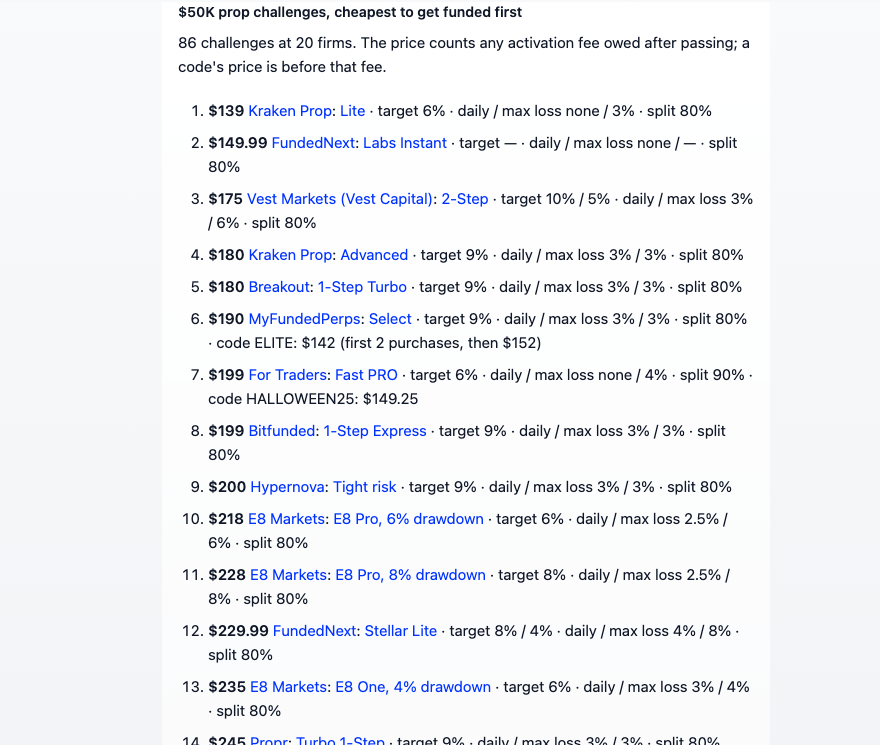

# OptimistFi

Perpetual futures across 40+ venues, crypto prop firms, and US company disclosures, as tools for Dify agents and workflows. No API key.

**Author:** [OptimistFi](https://optimistfi.com) · **Source:** [github.com/OptimistFi/dify-plugin-optimistfi](https://github.com/OptimistFi/dify-plugin-optimistfi) · **Contact:** hello@optimistfi.com

    

## Overview

OptimistFi reads every major perpetual futures venue each hour, the rules and prices of the prop firms that fund crypto and stock perps traders, and US company filings at SEC EDGAR and the US House Clerk. This plugin puts that data in Dify as eight tools.

**With it, an agent or workflow can answer:**

- Where funding, open interest and liquidations stand for BTC, ETH, NVDA, gold or 1,500+ other perps, venue by venue
- How Hyperliquid's largest accounts are positioned, and where the most positions would be liquidated
- Which prop challenge is cheapest at a given account size, counting any fee owed after passing, and which codes are live
- What a US company's insiders and House members have traded, and when each filing went public
- When a company reports next, marked as an estimate with its basis

## Configuration

There is nothing to configure: no API key, credential or authorization step.

1. Install **OptimistFi** from the Dify Marketplace.
2. The eight tools are ready in agents, Chatflows and Workflows.

The plugin connects to `https://mcp.optimistfi.com/mcp` over HTTPS, so a self-hosted Dify needs outbound network access to that host.

    

## Tools

| Tool | What it answers |
|---|---|
| **Perp Market** | One market across every venue right now: price, open interest, funding, leverage, liquidation levels, the largest trades, and how large accounts are positioned. |
| **Perp History** | One market over 1, 7, 30 or 90 days: price, open interest, funding, taker flow, and the net position of Hyperliquid accounts worth $10M+. |
| **Perps Screener** | 20 ranked views: open interest building, biggest moves, funding extremes and gaps between venues, liquidations, liquidation max pain, $100K+ trades, how $1M+ accounts lean, spot ETF flows, options, futures basis, fear and greed, sectors and more. |
| **Prop Firms** | Firms that fund crypto and stock perps traders: rules, every challenge's price (with any fee owed after passing), live discount codes, country and maximum allocation, read from each firm's own pages. |
| **Insider Trades** | A US company's Form 4 filings from SEC EDGAR, with the trade date and the date it became public. |
| **Congress Trades** | US House stock disclosures under the STOCK Act, by ticker or by member, each linked to its filing. |
| **SEC Filings** | 8-K events, earnings releases, 8-K text, and governance red flags (late filings, auditor changes, insider selling clusters). |
| **Earnings Calendar** | The next earnings date projected from the company's own filing cadence, labeled as an estimate with its basis. |

Labels, descriptions and forms are in English, Simplified Chinese, Japanese and Portuguese.

## Use cases

- **Perps desk agent.** One agent with all eight tools answers "where is ETH funding highest", "who is long SOL on Hyperliquid" and "what liquidates below 75K".
- **Morning briefing workflow.** A scheduled Workflow runs the screener's funding, movers and liquidations views and sends the summaries to Slack or email.
- **Prop firm finder.** A Chatflow takes an account size and a budget and returns the cheapest challenges with their rules and codes, each linked to the firm's page.
- **Insider and Congress watch.** A Workflow reads Insider Trades and Congress Trades for a watchlist and flags new filings.
- **Earnings week prep.** An agent lists who reports this week and pulls each company's recent 8-K events and red-flag checks.

## Example: a Chatflow that charts any market

1. **Start**: the user types a market, such as `BTC`.
2. **Perp History** tool node: *Market* set to the user's message (`sys.query`), *Window* `7d`.
3. **Answer** node: insert the tool node's `chart` variable, then its `text`.

Dify draws the chart from the `chart` output and renders the summary under it, as in the image at the top of this page.

## Example: the cheapest prop challenges at one account size

1. **Start**: any message.
2. **Prop Firms** tool node: *Account size (USD)* `50000`.
3. **Answer** node: insert the tool node's `text` variable.

The answer ranks every $50K challenge by what it costs to get funded, including any fee owed after passing, with each firm's rules and live codes, linked to its page.

    

## Example: an agent

Give an Agent app the OptimistFi tools and ask in plain language: "Which venue has the highest BTC funding, and how are Hyperliquid's largest accounts positioned?" It picks the tools, reads their summaries, and answers with the venue and time of each figure. With a small model, set *Response detail* to *Summary only* to keep its context small.

## Outputs in Workflows

Each tool node returns:

- `text`: a markdown summary with units, an as-of time and a source link. It is laid out to fit a chat bubble.
- `json`: the full records.
- Typed variables, such as `open_interest_usd`, `funding_annualized`, `next_earnings` and `count`.
- `error`: set when a call returns no data, so an *If/Else* node can branch on it.
- `chart` (perps tools): a ready-made chart. Insert it in an *Answer* node and Dify draws it.

Each tool's *Response detail* setting can leave out the full records (*Summary only*), which keeps an agent's context small.

## About the data

Every answer carries the time it was read and its source: each venue's public market data, SEC EDGAR or the US House Clerk. Where OptimistFi has not read something, the answer says so instead of returning an empty list. Dates projected forward are marked as estimates.

## Further information

- **OptimistFi:** [optimistfi.com](https://optimistfi.com) for the data on the web, and [optimistfi.com/mcp](https://optimistfi.com/mcp) for the MCP server behind this plugin.
- **Dify:** [dify.ai](https://dify.ai).

## Privacy

The plugin sends only each tool's inputs (a symbol, a firm name, a view) to OptimistFi. It collects no personal data and stores nothing. See [PRIVACY.md](PRIVACY.md).

## License

Released under the [MIT License](LICENSE).

---

**Disclaimer:** The data is for research and information. It is not investment advice, and the plugin places no orders and moves no money. Figures come from third-party sources at the time shown, can be revised, and are provided as is.
