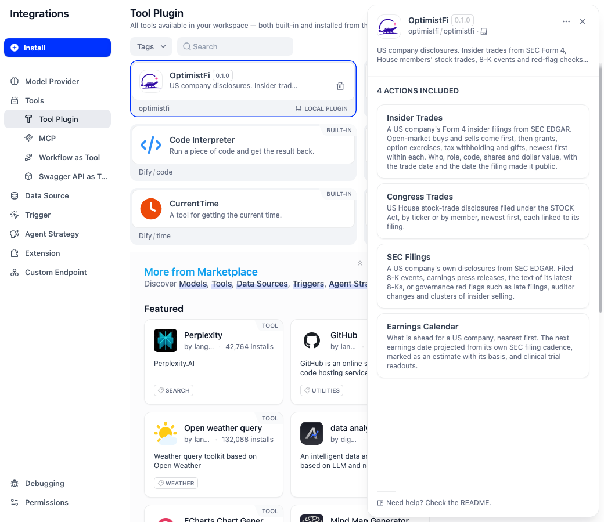
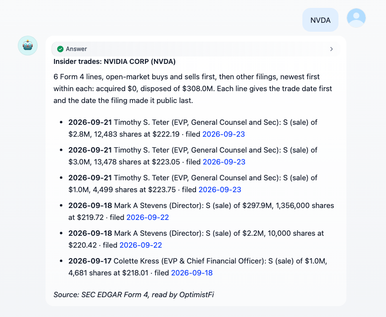

# OptimistFi

US company disclosures as tools for Dify agents and workflows: insider trades from SEC Form 4, House members' stock trades, 8-K events and red-flag checks from SEC EDGAR, and projected earnings dates. No API key.

**Author:** [OptimistFi](https://optimistfi.com) · **Source:** [github.com/OptimistFi/dify-plugin-optimistfi](https://github.com/OptimistFi/dify-plugin-optimistfi) · **Contact:** hello@optimistfi.com

    

## Overview

OptimistFi reads US company filings at SEC EDGAR and stock-trade disclosures at the US House Clerk. It dates each trade twice: the day it happened and the day the filing made it public. This plugin puts that data in Dify as four tools.

**With it, an agent or workflow can answer:**

- What a company's insiders have bought and sold, and when each Form 4 went public
- Which House members traded a stock, buys against sells, each linked to the filing
- What a company disclosed in its recent 8-Ks and earnings releases, and what those filings say
- Whether governance red flags have happened: late filings, auditor changes, clusters of insider selling
- When a company reports next, marked as an estimate with its basis

## Configuration

There is nothing to configure: no API key, credential or authorization step.

1. Install **OptimistFi** from the Dify Marketplace.
2. The four tools are ready in agents, Chatflows and Workflows.

The plugin connects to `https://mcp.optimistfi.com/mcp` over HTTPS, so a self-hosted Dify needs outbound network access to that host.

    

## Tools

| Tool | What it answers |
|---|---|
| **Insider Trades** | A US company's Form 4 filings from SEC EDGAR: who, role, Form 4 code, shares and dollar value, with the trade date and the date it became public. Open-market buys and sells come first, then grants, option exercises and gifts. |
| **Congress Trades** | US House stock disclosures under the STOCK Act, by ticker or by member. A ticker answer opens with buys, sells and the most active members; each line links to its filing. |
| **SEC Filings** | 8-K events, earnings press releases, the text of recent 8-Ks, and governance red flags (late filings, auditor changes, insider selling clusters). |
| **Earnings Calendar** | The next earnings date projected from the company's own filing cadence, labeled as an estimate with its basis, and clinical trial readouts where a company has them. |

Labels, descriptions and forms are in English, Simplified Chinese, Japanese and Portuguese.

## Use cases

- **Insider and Congress watch.** A scheduled Workflow reads Insider Trades and Congress Trades for a watchlist and sends new filings to Slack or email.
- **Earnings week prep.** An agent lists who reports this week and pulls each company's recent 8-K events and red-flag checks.
- **Due diligence agent.** One agent with the four tools answers "has anyone at Moderna sold shares this quarter", "which House members bought NVDA" and "has this company changed auditors".
- **8-K digest.** A Workflow reads the latest 8-K text for a list of companies and has a model summarize each one, with the filing linked.

## Example: a Chatflow for any ticker's insider trades

1. **Start**: the user types a ticker, such as `NVDA`.
2. **Insider Trades** tool node: *Company* set to the user's message (`sys.query`), *Rows* `10`.
3. **Answer** node: insert the tool node's `text` variable.

The answer lists the company's open-market buys and sells first, then other Form 4 filings, each with the trade date, the insider, the Form 4 code, the dollar value and the filing date, each linked to the filing at SEC EDGAR.

## Example: an agent

Give an Agent app the OptimistFi tools and ask in plain language: "Which House members traded NVDA this year, and have its insiders been selling?" It picks Congress Trades and Insider Trades, reads their summaries, and answers with the dates and filings behind each figure. With a small model, set *Response detail* to *Summary only* to keep its context small.

    

## Outputs in Workflows

Each tool node returns:

- `text`: a markdown summary with units, an as-of time and a source link. It is laid out to fit a chat bubble.
- `json`: the full records.
- Typed variables, such as `company`, `count`, `acquired_usd`, `disposed_usd`, `lean`, `flags_happened` and `next_earnings`.
- `error`: set when a call returns no data, so an *If/Else* node can branch on it.

Each tool's *Response detail* setting can leave out the full records (*Summary only*), which keeps an agent's context small.

## About the data

Every answer carries the time it was read and its source: SEC EDGAR or the US House Clerk. Each trade shows both the date it happened and the date it became public, so a workflow never treats a trade as known before its filing. Where OptimistFi has not read something, the answer says so instead of returning an empty list. Dates projected forward are marked as estimates.

## Further information

- **OptimistFi:** [optimistfi.com](https://optimistfi.com).
- **Dify:** [dify.ai](https://dify.ai).

## Privacy

The plugin sends only each tool's inputs (a ticker or company name, a House member's name, a filing kind) to OptimistFi. It collects no personal data and stores nothing. See [PRIVACY.md](PRIVACY.md).

## License

Released under the [MIT License](LICENSE).

---

**Disclaimer:** The data is for research and information. It is not investment advice, and the plugin places no orders and moves no money. Figures come from public filings at the time shown, can be revised, and are provided as is.
