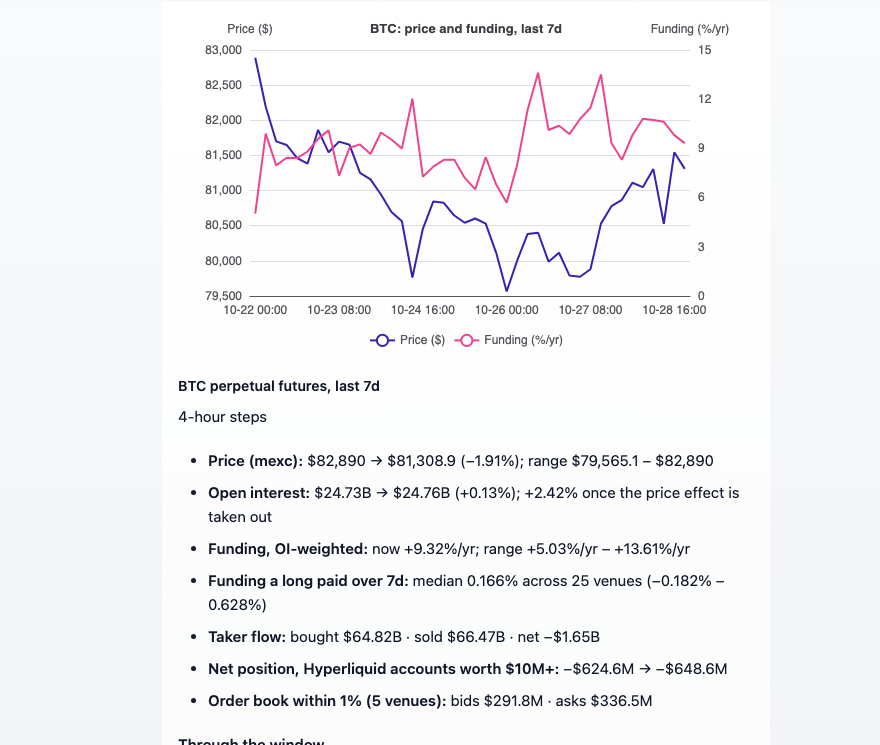

# OptimistFi

40 以上の取引所にわたる無期限先物、暗号資産プロップファーム、米国企業の開示情報を、Dify のエージェントとワークフローのツールとして提供します。API キーは不要です。

**作成者：** [OptimistFi](https://optimistfi.com) · **ソース：** [github.com/OptimistFi/dify-plugin-optimistfi](https://github.com/OptimistFi/dify-plugin-optimistfi) · **連絡先：** hello@optimistfi.com

    

## 概要

OptimistFi は主要な無期限先物取引所のデータを毎時読み取り、暗号資産・株式無期限先物のトレーダーに資金を提供するプロップファームのルールと価格、SEC EDGAR と米下院書記官室の企業開示を収集しています。このプラグインはそれを 8 つのツールとして Dify に提供します。

## 設定

設定は不要です。API キー、認証情報、承認手順はありません。Dify マーケットプレイスから **OptimistFi** をインストールすれば、8 つのツールをエージェント、Chatflow、Workflow で使えます。プラグインは HTTPS で `https://mcp.optimistfi.com/mcp` に接続するため、セルフホストの Dify ではこのホストへの外部通信が必要です。

## ツール

| ツール | 内容 |
|---|---|
| **無期限先物の銘柄** | 全取引所での単一銘柄の現状：価格、建玉、資金調達率、レバレッジ、清算水準、大口取引、大口口座のポジション。 |
| **無期限先物の推移** | 単一銘柄の 1・7・30・90 日の推移：価格、建玉、資金調達率、テイカーの売買、Hyperliquid の 1,000 万ドル以上口座のネットポジション。 |
| **無期限先物スクリーナー** | 20 のランキング：建玉の増加、値動き、資金調達率の極値と取引所間の差、清算、清算が集中する価格帯、10 万ドル以上の大口取引、100 万ドル以上口座のロング・ショート、現物 ETF のフロー、オプション、先物ベーシス、恐怖と強欲指数、セクターなど。 |
| **プロップファーム** | ルール、各チャレンジの価格（合格後のアクティベーション料を含む）、現在の割引コード、所在国、最大資金額。各社の公式ページから取得。 |
| **インサイダー取引** | SEC EDGAR の Form 4 届出。取引日と公開日付き。 |
| **米議員の株取引** | STOCK 法に基づく米下院の株取引開示。ティッカーまたは議員名で検索、届出へのリンク付き。 |
| **SEC 提出書類** | 8-K イベント、決算プレスリリース、8-K 本文、ガバナンス上の警告。 |
| **決算カレンダー** | 企業自身の提出周期から推定した次回決算日。推定であることと根拠を明記。 |

## ワークフローでの出力

各ツールノードは `text`（単位・取得時刻・出典リンク付きの Markdown 要約）、`json`（全レコード）、型付き変数、データがないときに設定される `error` を返します。無期限先物のツールは `chart` も返し、Answer ノードにツールノードの `chart` 変数を挿入すると Dify がグラフを描きます。「返す内容」の設定で要約のみを選ぶと、エージェントのコンテキストを小さく保てます。

## データについて

すべての回答に取得時刻と出典（各取引所の公開市場データ、SEC EDGAR、米下院書記官室）が付きます。読み取っていないものは空のリストではなくその旨を示し、将来の日付は推定と明記します。

## プライバシー

プラグインが OptimistFi に送るのは各ツールの入力（ティッカー、企業名、ビュー）だけです。個人データは収集せず、何も保存しません。[PRIVACY.md](../PRIVACY.md) を参照してください。

## ライセンス

[MIT ライセンス](../LICENSE)。

**免責事項：** データは調査と情報提供を目的としたもので、投資助言ではありません。プラグインは注文も送金も行いません。
