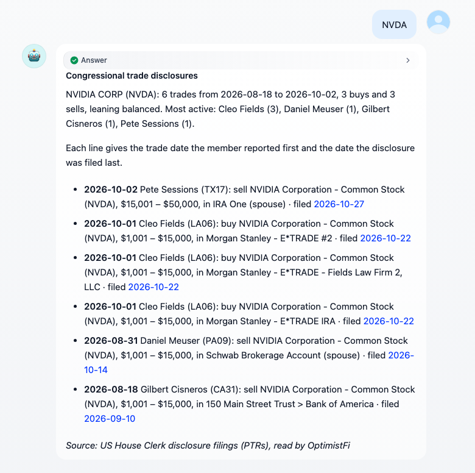

# OptimistFi

米国企業の開示情報を、Dify のエージェントとワークフローのツールとして提供します。SEC Form 4 のインサイダー取引、米下院議員の株取引、SEC EDGAR の 8-K イベントとレッドフラグ検査、予測決算日。API キーは不要です。

**作成者：** [OptimistFi](https://optimistfi.com) · **ソース：** [github.com/OptimistFi/dify-plugin-optimistfi](https://github.com/OptimistFi/dify-plugin-optimistfi) · **連絡先：** hello@optimistfi.com

    

## 概要

OptimistFi は SEC EDGAR の企業提出書類と米下院書記官室の株取引開示を読み取り、各取引に 2 つの日付を付けます。取引が行われた日と、届出で公開された日です。このプラグインはそのデータを 4 つのツールとして Dify に提供します。

## 設定

設定は不要です。API キー、認証情報、承認の手順はありません。Dify マーケットプレイスから **OptimistFi** をインストールすると、4 つのツールをエージェント、Chatflow、Workflow で使えます。プラグインは HTTPS で `https://mcp.optimistfi.com/mcp` に接続するため、セルフホストの Dify ではこのホストへの外部通信が必要です。

## ツール

| ツール | 内容 |
|---|---|
| **インサイダー取引** | SEC EDGAR の米国企業の Form 4 届出：人物、役職、取引コード、株数、金額。取引日と公開日付き。市場での買い・売りが先で、その後に付与、オプション行使、贈与が続きます。 |
| **議員の株取引** | STOCK 法に基づく米下院の株取引開示。ティッカーまたは議員で検索できます。ティッカーの回答は買い・売りと最も活発な議員から始まり、各行が取引した口座を示し、届出にリンクします。 |
| **SEC 提出書類** | 8-K イベント、決算プレスリリース、最近の 8-K 本文、ガバナンス上のレッドフラグ（届出遅延、監査人の交代、インサイダー売りの集中）。 |
| **決算カレンダー** | 企業自身の届出周期から予測した次回決算日。推定であることと根拠を明示します。臨床試験のある企業は試験結果の時期も示します。 |

## 利用例

- **インサイダーと議員取引の監視：** 定期実行の Workflow がウォッチリストのインサイダー取引と議員の株取引を読み、新しい届出を Slack やメールに送ります。
- **決算週の準備：** エージェントが今週決算を発表する企業を挙げ、各社の最近の 8-K イベントとレッドフラグ検査を取り出します。
- **デューデリジェンス用エージェント：** 4 つのツールを持つエージェントが「今四半期に Moderna で株を売った人はいるか」「NVDA を買った下院議員は誰か」「この会社は監査人を変えたか」に答えます。

## ワークフローでの出力

各ツールノードは `text`（単位、取得時刻、出典リンク付きの Markdown 要約）、`json`（全レコード）、型付き変数（`company`、`count`、`acquired_usd`、`lean`、`next_earnings` など）、データがないときに設定される `error` を返します。「返す内容」の設定で要約のみを選ぶと、エージェントのコンテキストを小さく保てます。

## データについて

各回答には取得時刻と出典（SEC EDGAR または米下院書記官室）が付きます。各取引には取引日と公開日の両方が示されます。OptimistFi が読み取っていないものは空のリストではなくその旨を伝え、将来の予測日は推定と明示します。

## プライバシー

プラグインが OptimistFi に送るのは各ツールの入力（ティッカーまたは企業名、下院議員の名前、届出の種類）だけです。個人データを収集せず、何も保存しません。詳しくは [PRIVACY.md](../PRIVACY.md) をご覧ください。

## ライセンス

[MIT ライセンス](../LICENSE)。

**免責事項：** データは調査と情報提供のためのもので、投資助言ではありません。プラグインは注文を出さず、資金も動かしません。
